  

# 🚀 Awesome Rapid Application Development (RAD) 

> ⚡ A comprehensive, SEO-optimized curated directory of top **Rapid Application Development (RAD)** platforms, enterprise **low-code** and **no-code** application builders, internal tool frameworks, and modern open-source alternatives. Build admin panels, customer portals, CRUD applications, and workflow automations 10x faster with minimal hand-coding! 🛠️

---

## 📋 Table of Contents

- [📈 Sector Overview & Market Dynamics](#-sector-overview--market-dynamics)
- [🟦 SaaS / Hosted Platforms](#-saas--hosted-platforms)
- [🟩 Open-Source Software](#-open-source-software)
- [📊 Comparison at a Glance](#-comparison-at-a-glance)
- [⭐ Star History](#-star-history)
- [💖 Support & Sponsorship](#-support--sponsorship)
- [🤝 Contributing](#-contributing)
- [📄 License](#-license)

---

## 📈 Sector Overview & Market Dynamics

📊 The global Low-Code & Rapid Application Development (RAD) market is estimated between **$26 billion and $37 billion in 2025**, projected to surpass **$100 billion by 2030** with an annual compound growth rate (CAGR) exceeding 25%–30% 🚀. 

🌐 The sector exhibits a **hybrid market structure**: it is **concentrated at the top** among established cloud and enterprise giants (such as OutSystems, Mendix/Siemens, Appian, and Retool) serving mission-critical enterprise workflows, while remaining **highly fragmented across mid-market and niche segments** with hundreds of specialized SaaS solutions, mobile-first builders, and a vibrant, fast-growing open-source ecosystem competing fiercely for developer mindshare 💡.

---

## 🟦 SaaS / Hosted Platforms

🏢 Below is a detailed breakdown of commercial, cloud-hosted Rapid Application Development platforms, ranked in descending order by **company size (estimated valuation / parent revenue)** 💰.

| 🏷️ Platform | 🎯 Type / Focus | 💎 Company Size (Valuation / Revenue) | 💳 Paid Pricing (Starting Tier) | 🎁 Free Forever Plan & Limits / Free Trial | 🌟 Best For |
| :--- | :--- | :--- | :--- | :--- | :--- |
| **[Zoho Creator](https://www.zoho.com/creator/)** | 📱 No-Code Business App Builder | **~$12B – $12.5B** valuation *(Parent revenue: ~$1.4B+ ARR)* | **$8/user/month** (Standard plan, billed annually) or via Zoho One bundle ($37/emp/mo) | **Free Forever Plan**: Capped at 3 users, 1 application, 5,000 records, and 50 MB storage | Teams invested in the Zoho ecosystem wanting integrated business workflows |
| **[OutSystems](https://www.outsystems.com/)** | 🏢 Enterprise Low-Code Application Platform | **~$9.5B** peak valuation *(Estimated ~$330M – $500M ARR)* | **~$36,300/year** (~$3,025/month base package for OutSystems Developer Cloud) | **Free Personal Edition**: Free forever for prototyping/learning, up to 100 internal users, non-production cloud sandbox | Large enterprises building high-scale customer-facing portals and core legacy modernizations |
| **[Appian](https://appian.com/)** | 🤖 Low-Code Automation & Process Orchestration | **~$3.6B** market cap *(NASDAQ: APPN; ~$843M TTM Revenue)* | **~$75/user/month** (Standard tier, annual contract with minimum seat floors) | **Appian Community Edition**: Free forever non-production sandbox environment, up to 15 users, includes Data Fabric and AI skills | Regulated industries, financial services, and government bodies requiring compliance audits and complex process orchestration |
| **[Retool](https://retool.com/)** | 🎛️ Low-Code Platform for Internal Tools & Portals | **~$3.2B** valuation *(~$100M+ ARR)* | **$10/month per builder** + $5/month per internal end-user (Team plan, billed annually) | **Free Forever Plan**: Capped at 5 total users, unlimited apps, 500 workflow runs/mo, 250 AI credits/mo | Fast-moving engineering teams building bespoke internal tools, CRUD panels, and database interfaces |
| **[Bubble](https://bubble.io/)** | 🌐 Full-Stack No-Code Web App Builder | **~$800M – $1B** estimated valuation *($106.3M raised; $1B+ community GMV)* | **$29/month** (Starter plan, billed annually; includes 175,000 Workload Units/mo) | **Free Forever Plan**: 1 app, full visual IDE and database builder, `.bubbleapps.io` subdomain, Bubble branding, testing & prototyping only | Solo founders, agencies, and non-technical builders launching full-stack SaaS MVPs without writing code |
| **[Mendix](https://www.mendix.com/)** | 📐 Model-Driven Enterprise Low-Code Platform | **$730M** acquisition valuation *(Siemens subsidiary; Digital Industries unit)* | **$1,090/month** (Standard Single-App plan, up to 50 users) or $2,725/mo for unlimited apps | **Free Edition**: Free forever access to Mendix Studio Pro, sandbox deployment environment with unlimited test users, no production SLA | Enterprise engineering organizations wanting model-driven architecture integrated into industrial IoT and SAP |
| **[FlutterFlow](https://www.flutterflow.io/)** | 📱 Visual Flutter & Dart Native App Builder | **~$170M** Series A valuation *(Raised ~$30M; 1M+ active builders)* | **$39/month** (Standard plan; unmetered code export, APK/IPA builds, custom domains) | **Free Forever Plan**: Capped at 2 active projects, full visual UI builder, web & mobile preview mode, no source code export or store deployment | Cross-platform engineers and startups building native iOS, Android, and web apps with clean Flutter source code |

---

## 🟩 Open-Source Software

💻 Self-hosted, community-driven Rapid Application Development frameworks and low-code alternatives. The table is ranked in descending order by **GitHub Stars_Count** 🌟.

| 📦 Framework | ⭐ GitHub_Stars | 📜 License | 🛠️ Primary Tech Stack | 📝 Description & Key Strengths |
| :--- | :--- | :--- | :--- | :--- |
| **[NocoDB](https://github.com/nocodb/nocodb)** |  | AGPL-3.0 | Node.js / Vue.js / TypeScript | Open-source smart spreadsheet and Airtable alternative. Transforms any existing relational database (PostgreSQL, MySQL, SQLite, SQL Server) into a collaborative, rich grid with REST/GraphQL APIs and webhooks. |
| **[Appsmith](https://github.com/appsmithorg/appsmith)** |  | Apache-2.0 | Java / React / TypeScript | Leading permissive open-source low-code framework to build admin panels, internal tools, and workflows. Connects to 30+ databases and APIs with drag-and-drop widgets and custom JS scripting. |
| **[ToolJet](https://github.com/ToolJet/ToolJet)** |  | GPL-3.0 / AGPL-3.0 | Node.js / React / PostgreSQL | Extensible open-source low-code internal tool builder with 40+ built-in UI components, 30+ database connectors, visual workflow automations, and multi-user role-based permissions. |
| **[Directus](https://github.com/directus/directus)** |  | BUSL-1.1 | Node.js / Vue.js / TypeScript | Instantly wraps any SQL database schema with intuitive REST and GraphQL APIs coupled with a real-time, customizable administrative app for non-technical users. |
| **[Refine](https://github.com/refinedev/refine)** |  | MIT | React / TypeScript / Next.js | Headless, code-first React framework for rapidly assembling enterprise internal tools, admin panels, CRM dashboards, and B2B platforms with maximum frontend flexibility. |
| **[Budibase](https://github.com/Budibase/budibase)** |  | GPL-3.0 / Source-Available | Node.js / Svelte / CouchDB | All-in-one low-code developer platform featuring a built-in database, connectors for Postgres, MySQL, and REST, visual design tools, and an automation engine for scheduled tasks. |
| **[Windmill](https://github.com/windmill-labs/windmill)** |  | AGPL-3.0 | Rust / Go / TypeScript / Python | Ultra-fast code-first developer platform that converts scripts (Python, TypeScript, Go, Bash, SQL) into auto-generated webhooks, UIs, and asynchronous distributed background workflows. |
| **[Amplication](https://github.com/amplication/amplication)** |  | Apache-2.0 | Node.js / TypeScript / NestJS | Open-source backend code-generation engine that builds production-ready Node.js/NestJS and React/GraphQL services with database schema management and GitHub sync. |
| **[ILLA Cloud](https://github.com/illacloud/illa-builder)** |  | Apache-2.0 | Go / React / TypeScript | Low-code platform with native AI agent integration, allowing developers to visually connect AI models, databases, and APIs into real-time collaborative admin tools. |
| **[Baserow](https://github.com/baserow/baserow)** |  | MIT | Python / Django / Vue.js | Open-source no-code database and visual application builder. Features 20+ field types, real-time collaboration, and an Application Builder module to construct public and private portals. |
| **[Mathesar](https://github.com/mathesar-foundation/mathesar)** |  | GPL-3.0 | Python / Django / Svelte | Open-source spreadsheet-like GUI tool specifically architected on top of PostgreSQL, enabling users to create schemas, queries, and data workflows without SQL expertise. |
| **[Saltcorn](https://github.com/saltcorn/saltcorn)** |  | MIT | Node.js / PostgreSQL | Lightweight, end-to-end no-code application platform designed for simple self-hosting on low-spec VPS servers with a visual drag-and-drop UI and extensible plugin system. |
| **[Lowcoder](https://github.com/lowcoder-org/lowcoder)** |  | AGPL-3.0 | Java / React / TypeScript | Open-source low-code builder for internal tools with plugin modules, mobile responsive layouts, and native database connectors. |

---

## 📊 Comparison at a Glance

| 🛠️ Software | 📜 License | ☁️ Model | 🎨 UI Builder | 🗄️ Database Layer | ⚙️ Primary Stack | 🎯 Best For |
| :--- | :--- | :--- | :--- | :--- | :--- | :--- |
| **Zoho Creator** | Proprietary | SaaS | Drag-and-drop | Hosted Zoho DB | Cloud Hosted | Integrated business apps & SMB suites |
| **OutSystems** | Proprietary | SaaS / Dedicated | Visual Studio | Enterprise Connectors | .NET / Cloud | Enterprise mission-critical applications |
| **Appian** | Proprietary | SaaS / Self-Host | Visual Process | Enterprise Data Fabric | Java / Cloud | Regulated process automation & compliance |
| **Retool** | Proprietary | SaaS / On-Prem | Drag-and-drop | 30+ DB Connectors | Node / React | Fast internal dashboards & CRUD tooling |
| **Bubble** | Proprietary | SaaS | Visual Full-Stack | Hosted NoSQL DB | Node / Cloud | Full SaaS MVP launches without code |
| **Mendix** | Proprietary | SaaS / On-Prem | Model-Driven | Cloud / Edge | Java / Siemens Cloud | Enterprise IoT and model-driven systems |
| **FlutterFlow** | Proprietary | SaaS / Desktop | Drag-and-drop | Firebase / Supabase | Flutter / Dart | Native iOS/Android/Web applications |
| **NocoDB** | AGPL-3.0 | Open-Source | Smart Grid | Any SQL Database | Node.js / Vue | Airtable alternative on your own SQL database |
| **Appsmith** | Apache-2.0 | Open-Source | Drag-and-drop | Connectors & APIs | Java / React | Permissive OSS internal tools & embedding |
| **ToolJet** | GPL/AGPL | Open-Source | 40+ Components | 30+ Connectors | Node.js / React | Feature-dense self-hosted Retool alternative |
| **Directus** | BUSL-1.1 | Source-Available | Dynamic Admin | Any SQL Database | Node.js / Vue | Instant REST/GraphQL API + Admin for SQL |
| **Refine** | MIT | Open-Source | React Headless | Any Backend/REST | React / Next.js | Code-first flexible internal dev frameworks |
| **Budibase** | GPL-3.0 | Open-Source | Drag-and-drop | Built-in + External | Node.js / Svelte | Automated internal portals with workflows |
| **Windmill** | AGPL-3.0 | Open-Source | Script-Generated | PostgreSQL | Rust / TS / Python | Code-first script-to-UI workflow engines |
| **Amplication** | Apache-2.0 | Open-Source | Schema Builder | PostgreSQL / MySQL | TypeScript / NestJS | Production-ready backend & API generation |
| **ILLA Cloud** | Apache-2.0 | Open-Source | Drag-and-drop | APIs & AI Models | Go / React | AI-augmented low-code dashboards |
| **Baserow** | MIT | Open-Source | Grid & App Builder | Built-in Postgres | Python / Vue | Open-source modular Airtable + App builder |
| **Mathesar** | GPL-3.0 | Open-Source | Spreadsheets | PostgreSQL Native | Python / Svelte | Direct PostgreSQL web interface & forms |
| **Saltcorn** | MIT | Open-Source | Drag-and-drop | PostgreSQL / SQLite | Node.js / Express | Ultra-lightweight self-hosted no-code |
| **Lowcoder** | AGPL-3.0 | Open-Source | Drag-and-drop | Database Connectors | Java / React | Clean modular self-hosted internal tools |

---

## ⭐ Star History

---

## 💖 Support & Sponsorship

Thank you so much for exploring and using this curated directory! 🙏

If you find this repository helpful, please consider supporting the project:
- ⭐ **Star** this repository on GitHub
- 🍴 **Fork** and contribute back with awesome tools
- 📢 **Share** it on Twitter/X, LinkedIn, and developer communities
- ☕ **Buy me a coffee / Sponsor**: If you'd like to support ongoing maintenance and new features, visit the [GitHub Sponsors Dashboard](https://github.com/sponsors/ishandutta2007)!

Your support is deeply appreciated and keeps open-source research alive! 🌟✨

---

## 🤝 Contributing

Contributions are warmly welcome! 🙌 If you know of an outstanding open-source Rapid Application Development framework, low-code tool, or internal app builder that belongs on this list:

1. 🍴 Fork this repository.
2. ➕ Add your tool to the table (keeping it sorted by Stars_Count).
3. 🔗 Include project links, license, tech stack, and a clear description of why it stands out.
4. 🚀 Submit a Pull Request.

---

## 📄 License

This compilation is licensed under the [Creative Commons Zero v1.0 Universal](https://creativecommons.org/publicdomain/zero/1.0/) (CC0 1.0) Public Domain Dedication. Individual software products and frameworks listed belong to their respective copyright holders.

---

  <b>⭐ If you found this RAD directory valuable, consider starring the repository! ⭐</b>

